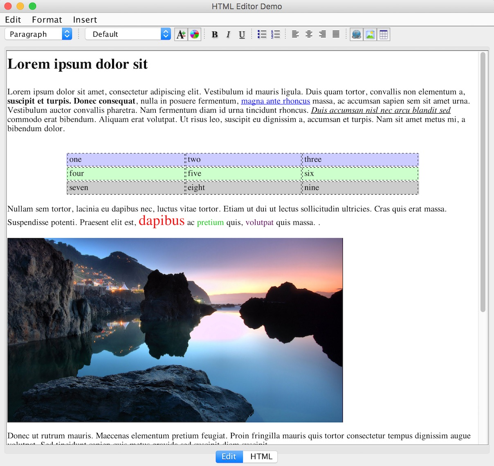

# SHEF

SHEF (Swing HTML Editor Framework) is a WYSIWYG HTML editor framework and embeddable component for Swing.
It makes it easier to work with `JEditorPane` and provides both a visual editor and an HTML source editor.

## Features

- HTML source editor with syntax highlighting
- Context-sensitive Swing actions
- Unlimited undo and redo
- Table creation and editing
- Resizable tables and images
- Embeddable in Swing applications
- Image insertion from files and the system clipboard
- Font selection using WYSIWYG font names

## Demo

A demo application is included in the project.
Its main class is `net.atlanticbb.tantlinger.shef.Demo`.

## Build

The project uses Maven. Run `mvn package` to build it.
The current Maven configuration targets Java 11.

## Changes History

### Original SourceForge project

The original SHEF project was distributed through [SourceForge](https://sourceforge.net/projects/shef/).
It established the Swing HTML editor framework,
including WYSIWYG HTML editing and the original editor component and actions.

### VEDAGroup fork

[VEDAGroup's fork](https://github.com/VEDAGroup/SHEF) carried forward the SourceForge code
and included fixes to the original project.

### kkieffer fork

[kkieffer's fork](https://github.com/kkieffer/SHEF), based on the VEDAGroup version,
added several editor improvements:

- The HTML source tab can be hidden.
- The image attributes dialog can browse for image files.
- Menu shortcuts use platform-appropriate modifier keys.
- Icons and other visual details were updated.
- The font selector displays WYSIWYG fonts.
- Images can be pasted from the system clipboard.

### This fork

This fork continues the kkieffer version and includes the following major changes:

- Migrated the project build to Maven.
- Modernized the source code across the project to use Java 8 syntax and conventions.
- Replaced `novarworx.syntax` with [RSyntaxTextArea](https://github.com/bobbylight/RSyntaxTextArea) for HTML source editing and syntax highlighting.
- Replaced the SAM binary dependency with SAM source code recovered by decompiling the library, and integrated that code into the project. See [SAM documentation](SAM.md).
- Added the `net.atlanticbb.tantlinger.ui.ImageHandler` interface to intercept images pasted from the clipboard or selected from the local disk, and provide a URL for the image before it is added to the document. The default implementation, `net.atlanticbb.tantlinger.ui.ImageHandlers.Default`, returns a URL pointing to the local image file (thus mimicking the original behavior). Custom handlers can instead generate a Data URL or upload the image to a cloud storage and return its URL.
- Exposed most parts of `HTMLEditorPane` via public properties. These can be used to customize the component or interact with it.
- Added a `toolbarMask` property to `HTMLEditorPane` to control which toolbar items are displayed or not.

The current `pom.xml` sets the Java compiler release to 11.

## License

This project retains the original [GNU Lesser General Public License, version 2.1](https://www.gnu.org/licenses/old-licenses/lgpl-2.1.html).
See [LICENSE](LICENSE) for the license text.

## Project Links

- [Original SHEF project](https://shef.sourceforge.net/)
- [VEDAGroup fork](https://github.com/VEDAGroup/SHEF)
- [kkieffer fork](https://github.com/kkieffer/SHEF)
